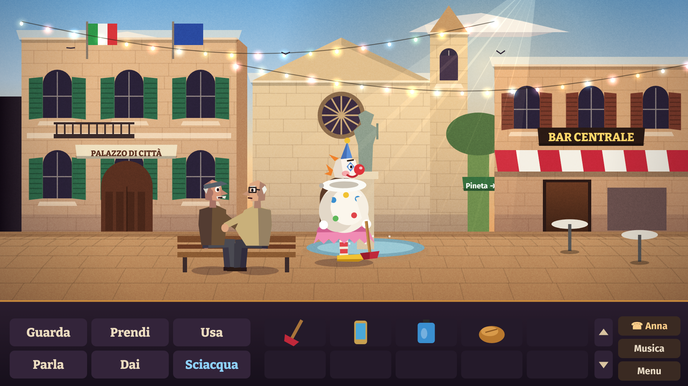

# SuperTeleMurgia: La Leggenda dello Sciacquone

A vulgar, tacky, very Southern Italian point-and-click adventure. Sciacquone the clown, armed with a plunger and wearing a toilet seat as a collar, has to save Gravina from the Clan dei Pallonari, a nuclear waste dump and a McPallon's.

**▶ Play the demo in your browser:** `https://<your-github-user>.github.io/supertelemurgia/` (see [Publish on GitHub Pages](#publish-on-github-pages))



- 4 acts across Gravina, Altamura and Matera, plus a secret one in Santeramo (which doesn't exist)
- ~2 hours, 3 endings, 14 achievements, a hint hotline (Anna)
- Music composed live in the browser: it never loops the same way twice
- Text in Italian

## Repository layout

| Folder | What's in it |
|---|---|
| `game/src/` | The whole game: engine, audio, art and four content files (one per act group) |
| `game/build.py` | Builds every version of the game from `game/src` |
| `desktop/` | Electron wrapper for Steam and the Microsoft Store (achievements, fullscreen, offline fonts) |
| `android/` | Android app for Google Play: offline WebView wrapper with touch controls, haptics and the back button |
| `launcher/` | Tiny Go program that turns the game into a single Windows `.exe` |
| `steampipe/` | Scripts to upload builds to Steam |
| `store/` | Store art, screenshots, achievement icons and store text |
| `packaging/` | Read-me files shipped inside the download zips |
| `tests/` | Automated playthrough to the ending, plus a touch test on an emulated Android phone |
| `.github/workflows/` | Cloud builds, tests, releases and GitHub Pages |

## Build

Only Python 3 is needed to build the game itself:

```
python game/build.py
```

| Output | Use |
|---|---|
| `dist/web/index.html` | Full game, open in any browser |
| `dist/demo/index.html` | Free demo, stops after Act I |
| `dist/dev/index.html` | Full game with debug hooks, used by the tests |
| `desktop/game/index.html` | Game page for the Electron / Steam build |
| `launcher/game.html` | Game page embedded in the Windows `.exe` |

To play locally, open `dist/web/index.html` in a browser.

## Test

```
pip install playwright
python -m playwright install chromium
python game/build.py
python tests/playthrough.py
```

The test plays the full game (all four acts, Santeramo and the good ending) and fails on any script error or unreachable puzzle step.

## Publish on GitHub Pages

1. Push this repository to GitHub.
2. **Settings → Pages → Source: GitHub Actions.**
3. Every push to `main` publishes the game at `https://<your-github-user>.github.io/supertelemurgia/`.

`.github/workflows/pages.yml` publishes the **demo** by default, so the full game can still be sold. Change `PAGES_VERSION: demo` to `web` to publish the full game for free.

> GitHub Pages is free for **public** repositories. A public repository also makes the full source code visible, so anyone could build the full game. To sell the game, keep this repository private (Pages on private repos needs a paid GitHub plan), or create a second public repository that only contains `dist/demo/index.html`.

### Easier to share
- Shared on WhatsApp, Instagram, Facebook or X, the Pages link shows a preview card with the game's art (`web/og.png`).
- On phones, players can tap **Share → Add to Home Screen**: the game gets its own icon and opens full screen like an app (`web/manifest.webmanifest`).
- Held upright, phones show a "turn your phone" screen; the game is played in landscape.

## Downloads and releases

`.github/workflows/build.yml` runs on every push and builds, in the cloud:

- `SuperTeleMurgia-Windows.zip` (lightweight `.exe`)
- `SuperTeleMurgia-Mac-Linux.zip`
- `SuperTeleMurgia-web.zip` and `SuperTeleMurgia-DEMO-web.zip` (for itch.io, Game Jolt, Newgrounds)
- `SuperTeleMurgia-Steam-Windows.zip` (the Electron build to upload to Steam)

They appear under **Actions → latest run → Artifacts**. To publish them as a GitHub Release:

```
git tag v1.0.0
git push --tags
```

## Steam

1. Create a Steamworks account and pay the app fee; you get an **App ID** and a **Depot ID**.
2. Put the App ID in `desktop/package.json` (`steam.appId`), `desktop/steam_appid.txt` and `steampipe/app_build.vdf`; put the Depot ID in `app_build.vdf`.
3. Create the 14 achievements listed in `store/achievements.csv` (API names must match).
4. Build: download `SuperTeleMurgia-Steam-Windows.zip` from Actions, or locally run `cd desktop && npm install && npm run dist:win`.
5. Upload with `steampipe/upload.bat` (needs the Steamworks SDK and your login).
6. Store page assets and text are in `store/`.

Cloud saves: Steamworks → Steam Cloud → Auto-Cloud, root `WinAppDataRoaming`, subdirectory `SuperTeleMurgia/Local Storage/leveldb`, pattern `*`.

## Microsoft Store

1. Free individual developer account at Partner Center; reserve the name.
2. Copy the package identity values into `desktop/package.json` → `build.appx`.
3. `cd desktop && npm install && npm run dist:store`, then upload the `.appx`.

## Android and Google Play

The phone version is the same game with a touch layer that switches on by itself on any touch screen
(also in mobile browsers): tap to act, hold to look, drag your finger to read object names, a lens
button that reveals every hotspot, big dialogue buttons, larger text, haptics, and Back = menu.

- **Cloud build (easiest):** push to GitHub. The *Android* workflow builds `app-debug.apk`
  (install it on your phone to test) and `app-release.aab` (upload it to Google Play).
- **Signing:** run `android/make-upload-key.sh` (or `.ps1` on Windows) once, then add the four
  `STM_*` secrets it prints to the repository. Back up `upload-key.jks`; never commit it.
- **Local build:** install Android Studio, run `python game/build.py`, then open the `android/`
  folder, or run `cd android && ./gradlew assembleDebug`.
- **Store kit:** `store/googleplay/` has the listing text (Italian and English), icon, feature
  graphic, phone screenshots and the answers for Play Console's App content forms.
- Package name: `com.supertelemurgia.game` (change it in `android/app/build.gradle` before the first upload if you want another; it can never change afterwards).

## License

All rights reserved. See [LICENSE](LICENSE). Fonts are under the SIL Open Font License.
